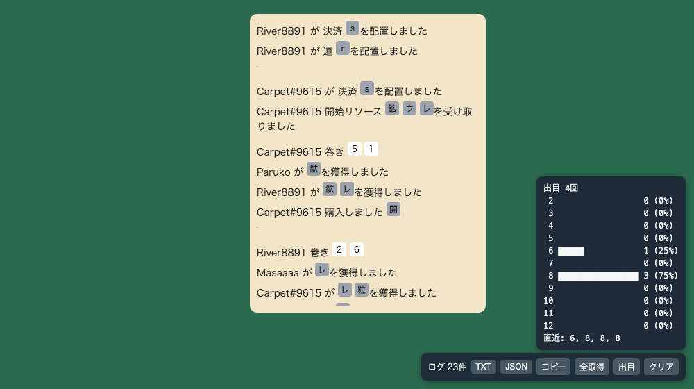
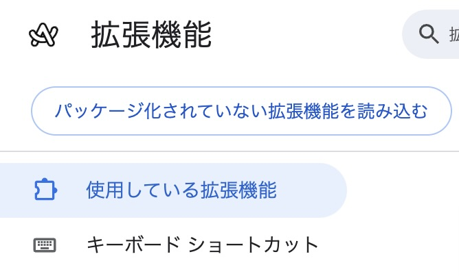

# Colonist Log Saver

[colonist.io](https://colonist.io) のゲームログを全部集めて、TXT / JSON で保存できる Chrome / Arc 拡張機能です。ログ欄の出目から、出目の集計も出せます。

ログ欄は仮想スクロールで、画面外の行は消えてしまいます。この拡張は、ログ欄を先頭から末尾まで自動でスクロールして全行を拾い、右下のパネルに溜めていきます。



*画像は動作確認用に作ったダミーページ上の表示イメージです。*

## できること

- ゲームログの収集（チャット発言は除外）
- 「TXT」「JSON」で保存、「コピー」でクリップボードへ
- 「出目」で、2〜12 の回数・割合・直近10回を表示
- 「全取得」で、ログ欄を最初までスクロールして取りこぼしを拾う
- ログの欠けを検知して、パネルに「欠けN」と表示

保存されるログの例:

```
Carpet#9615 が 決済 [settlement]を配置しました
Carpet#9615 巻き 🎲5 🎲1
Paruko が [鉱石]を獲得しました
```

## インストール手順

### ワンライナー（macOS）

ターミナルに貼り付けて実行します。`~/chrome-extensions/Colonist-Log-Saver-main` に展開されます。

```sh
mkdir -p ~/chrome-extensions && curl -sL https://github.com/mksmkss/Colonist-Log-Saver/archive/refs/heads/main.tar.gz | tar -xz -C ~/chrome-extensions && open ~/chrome-extensions
```

その後、下の「拡張機能を読み込む」に進んでください（Chrome / Arc の仕様で、読み込みだけは手動です）。

### ZIPをダウンロードする場合

1. このリポジトリのページで緑色の「Code」ボタンをクリックします
2. 「Download ZIP」を選択します
3. ダウンロードしたZIPを、消さない場所に解凍します（解凍先のフォルダを読み込み続けるため）

### 拡張機能を読み込む

1. ChromeまたはArcのアドレスバーに以下を入力します

   ```
   chrome://extensions/
   ```

   または

   ```
   arc://extensions/
   ```

2. 右上の「デベロッパーモード」をONにします
3. 左上に表示される「パッケージ化されていない拡張機能を読み込む」をクリックします

   

4. 解凍した `Colonist-Log-Saver-main` フォルダを選択します
5. 一覧に「Colonist Log Saver」が表示されれば完了です
6. colonist.io のページを開き直します

## 更新

ワンライナーをもう一度実行すると上書きされます。その後 `chrome://extensions/`（または `arc://extensions/`）で、この拡張機能の更新ボタン（円形の矢印）を押し、colonist.io を開き直してください。

## 使い方

1. colonist.io のゲームページを開くと、右下にパネルが出ます
2. ページを開いて約2.5秒後に、ログ欄が自動で先頭から末尾までスクロールされ、全部拾われます（元の位置に戻ります）
3. 「ログ N件」の件数が増えていきます。欠けがあれば「（欠けN）」と出るので、「全取得」を押してください
4. 「TXT」「JSON」で保存、「出目」で集計を表示します
5. URLのハッシュ（`#farm5976` など）が変わると、新しいゲームとして自動でクリアされます

## トラブルシューティング

- パネルが出ない：`chrome://extensions/` で拡張機能がONか、colonist.io を開き直したかを確認してください
- 件数が0のまま：colonist.io 側の表示（クラス名など）が変わった可能性があります。Issueで教えてください
- 出目が合わない：パネルに「欠け」が出ていないか確認し、出ていれば「全取得」を押してください

## 権限について

この拡張は `https://colonist.io/*` のページにだけスクリプトを入れます。ログは保存ボタンを押したときに、ブラウザのダウンロードとして手元に出るだけで、外部には送信しません。

## ライセンス

MIT
